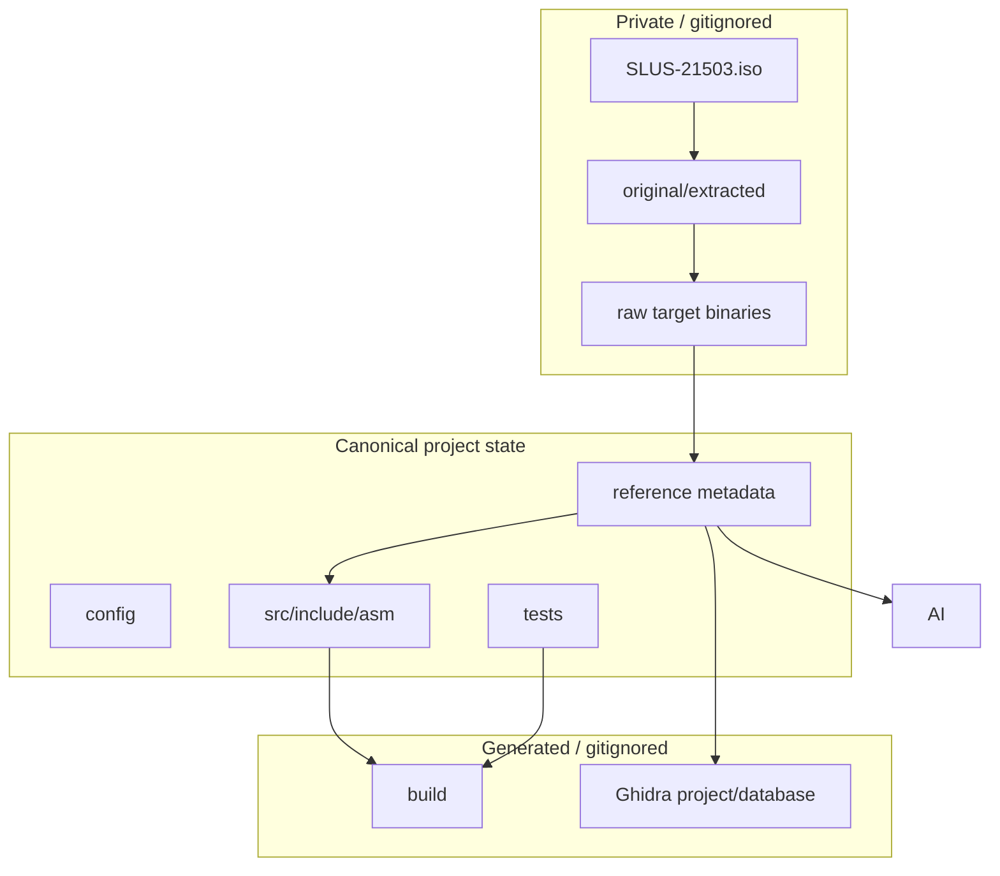
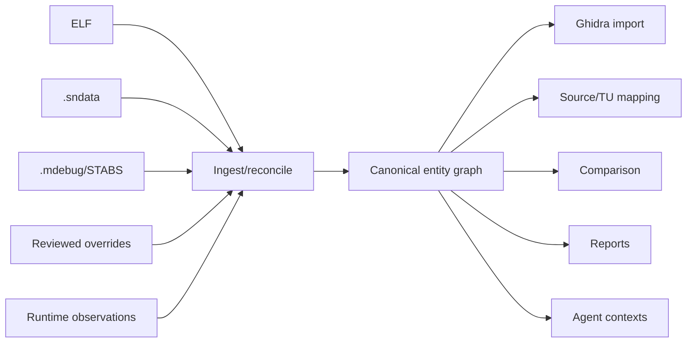
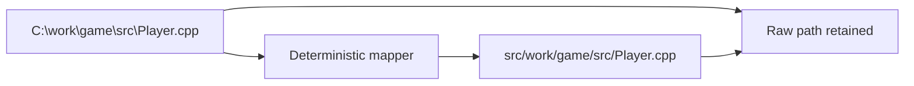
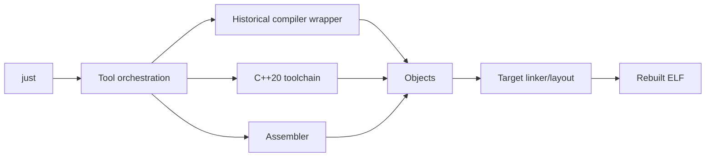
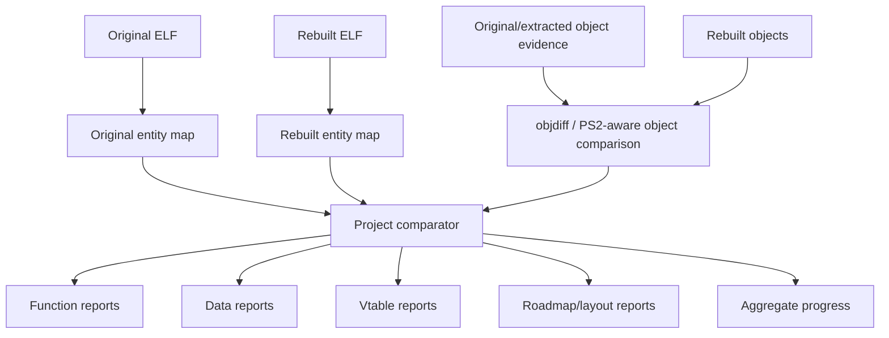
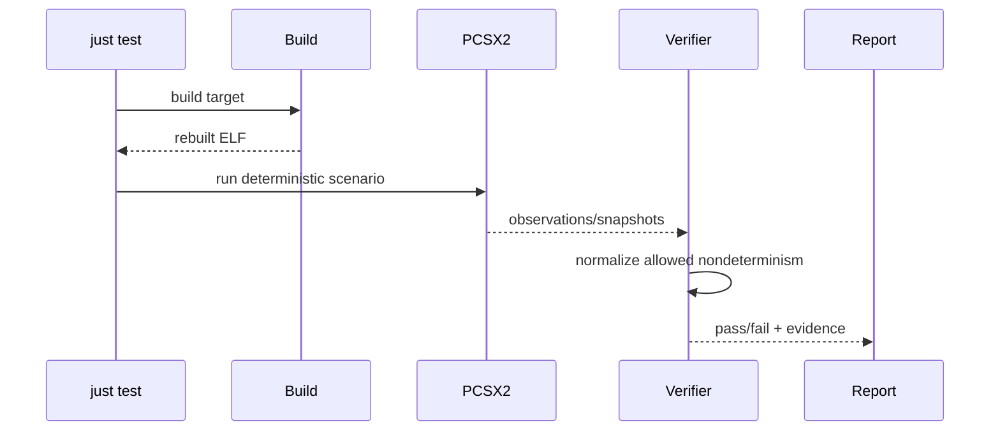
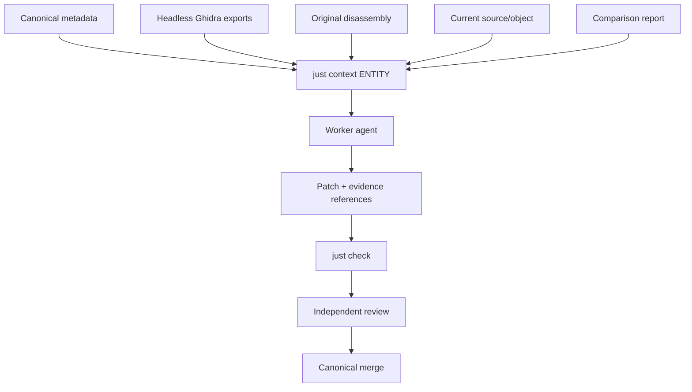
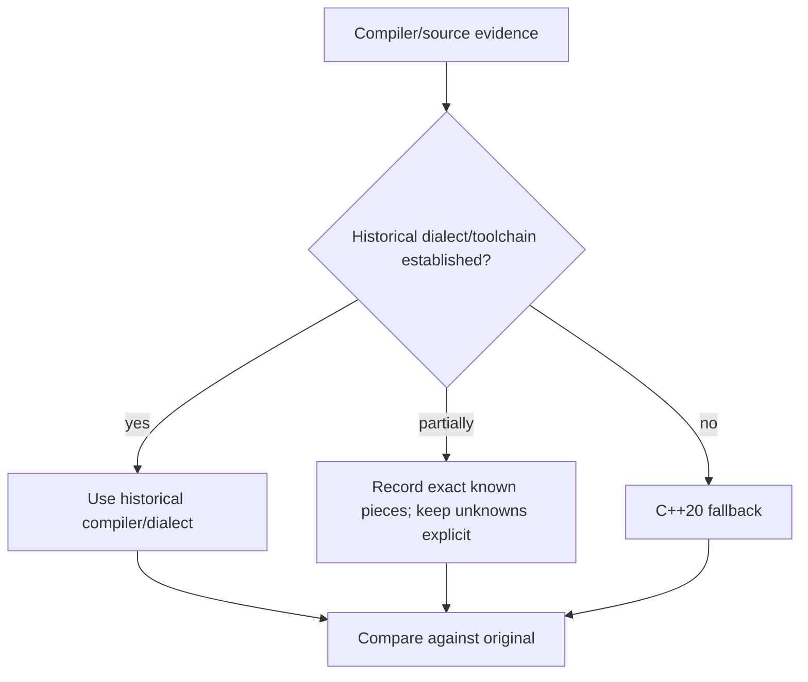

# Architecture

## System boundary

The repository contains both publishable reconstruction work and private original game inputs.



Private binaries are evidence inputs, not repository dependencies that may be published accidentally.

## Canonical evidence model

All tools converge on one canonical entity graph.



Ghidra is a consumer and analysis producer. It is not the sole source of truth.

## God Hand tooling boundary decision

The stable operator API remains `tools/godhand.py`; it is a compatibility
wrapper only. Its implementation is split into the smallest evidence-backed
package under `tools/godhand_tool/`:

| Module | Owner and responsibility | Depends on |
| --- | --- | --- |
| `repository.py` | repository paths, hashing, provenance, private-input inventory, and complete tool identity | standard library |
| `elf.py` | ELF section-table and SNR2 extraction | `repository` |
| `schema.py` | closed record/provenance validation | `repository` |
| `serialization.py` | JSON/JSONL writers and sidecar composition | `repository` |
| `commands.py` | command orchestration and generated artifact composition | `repository`, `elf`, `schema`, `serialization` |
| `cli.py` | argparse surface and dispatch | `commands` |

Dependencies point from the CLI/orchestration adapters toward stable evidence,
serialization, and validation services; no lower-level module imports the CLI.
`repository.py` computes the tool provenance hash across the wrapper and every
Python module recursively beneath the package tree, excluding cache families,
using sorted POSIX repository-relative paths and length-delimited content;
`check` recomputes that aggregate independently through provenance validation.
Candidate identity excludes the entire `original/` private-input root, as well
as generated roots and explicit local-cache families, before hashing the
canonical file paths and contents. The separate input manifest continues to
scan `original/` for private-input identity and validation.
This is a real boundary because extraction, validation, and serialization have
independent invariants and can be tested without changing command dispatch.

Rejected alternatives: keeping one 1,074-line command module (the pre-change
audit exceeded the review threshold), a speculative class hierarchy, and a
new executable entrypoint. The rollback boundary is the wrapper plus this
package: restoring the previous monolith preserves the CLI and behavior
contracts, but changes implementation provenance; all reference metadata must
therefore be regenerated before `just check` can pass.

## Entity identity

Stable identities use original target coordinates where possible.

Examples:

```text
target:GAME/function:0x00123450
target:GAME/global:0x00381240
target:GAME/vtable:0x00390000
target:GAME/section:.text
```

A canonical entity may contain many names:

```json
{
  "id": "target:GAME/function:0x00123450",
  "address": "0x00123450",
  "names": {
    "sndata_raw": "_ZN7CPlayer6UpdateEv",
    "demangled": "CPlayer::Update()",
    "canonical": "CPlayer::Update"
  }
}
```

Raw debug names are never overwritten.

## Evidence representation

Each factual property carries provenance.

```json
{
  "source_file": {
    "value": "C:\\work\\game\\src\\Player.cpp",
    "evidence": [
      {
        "kind": "stabs",
        "artifact": "target.elf",
        "record": "..."
      }
    ],
    "confidence": "exact"
  }
}
```

Allowed confidence states:

```text
exact
strong
inferred
unknown
conflicted
```

`conflicted` is first-class; reconciliation must not erase competing evidence.

## Debug path mapping

Raw historical paths and repository paths are distinct values.



Mapping rules must be versioned and deterministic.

Do not derive directories from symbol namespaces unless the result is explicitly stored as a non-canonical hypothesis.

## Build architecture

The Justfile is the stable operator/agent API.



Compiler selection is per translation unit if evidence requires it.

A compiler wrapper isolates host constraints. Historical tools may run through Wine, emulation, a VM, or another execution mechanism without changing the repository-facing build contract.

## Comparison architecture

Do not force PS2/MIPS into reccmp's x86/PDB implementation. Preserve the workflow and semantics.



The project comparator owns:

- original↔recompiled entity association;
- annotations;
- path/TU consistency;
- aggregate progress;
- data/vtable/layout checks;
- report production.

PS2-aware tools own architecture-specific disassembly and relocation handling where appropriate.

## Runtime verification

Static similarity and functional correctness are separate dimensions.



Runtime observations must specify what is compared and what is intentionally ignored or normalized.

## Agent architecture

Agents receive generated bounded context, not arbitrary mutable state.



The manifest records repository commit, original-input hash, tool versions, and generation command.

## Agent authority boundaries

### Analysis agent

May:

- add evidence;
- identify contradictions;
- propose names/types/TU assignments;
- produce hypotheses.

May not:

- silently promote hypotheses to exact facts.

### Source agent

May:

- reconstruct source from canonical evidence;
- modify declarations needed by its assigned slice.

Must:

- cite entity/evidence IDs in the slice record;
- preserve known historical naming/style.

### Verification agent

May:

- build;
- compare;
- run tests;
- reject unsupported changes.

Should not be the sole reviewer of its own source reconstruction.

### Orchestrator

Owns:

- slice allocation;
- dependency tracking;
- collision prevention;
- status transitions;
- aggregate progress.

It does not invent reverse-engineering facts.

## Source annotations

Keep ISLE/reccmp-style address anchoring.

```cpp
// FUNCTION: GAME 0x00123450
void CPlayer::Update()
{
}
```

Additional machine-readable metadata should live in canonical files rather than bloating comments. Comments remain deterministic anchors and human-readable validation points.

Functions within recovered translation units are ordered by original address unless stronger source-order information is available.

## PS2-specific analysis

Preferred analysis stack:

- Ghidra Emotion Engine Reloaded for R5900/MMI/VU0-macro-aware analysis;
- its STABS support for `.mdebug` when applicable;
- `ccc`/`stdump`/`uncc` for machine-readable PS2 debug extraction;
- `.sndata` parser preserving all raw fields;
- PS2/MIPS-capable object comparison such as `objdiff`;
- `splat` where useful for binary splitting.

The project must retain raw decoded debug records even when higher-level tooling fails to understand them.

## Language/toolchain policy



C++20 is a fallback implementation language, not evidence about the original source.

## Deterministic generated artifacts

Every generated artifact that influences canonical decisions should embed or accompany:

```text
input SHA-256
repository commit
tool name/version
configuration hash
command/invocation identity
timestamp only if informational, never as semantic input
```

Reports should therefore be reproducible and attributable.

## References

- LEGO Island decompilation: <https://github.com/isledecomp/isle>
- reccmp: <https://github.com/isledecomp/reccmp>
- LEGO Racers decompilation conventions: <https://github.com/isledecomp/racers>
- objdiff: <https://github.com/encounter/objdiff>
- splat: <https://github.com/ethteck/splat>
- Ghidra Emotion Engine Reloaded: <https://github.com/chaoticgd/ghidra-emotionengine-reloaded>
- ccc: <https://github.com/chaoticgd/ccc>
