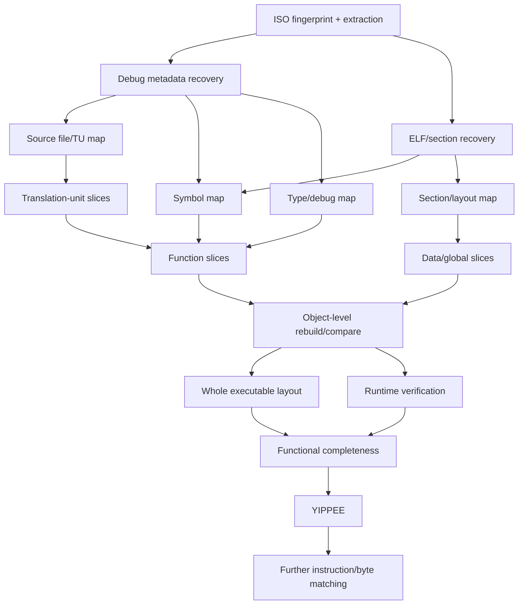
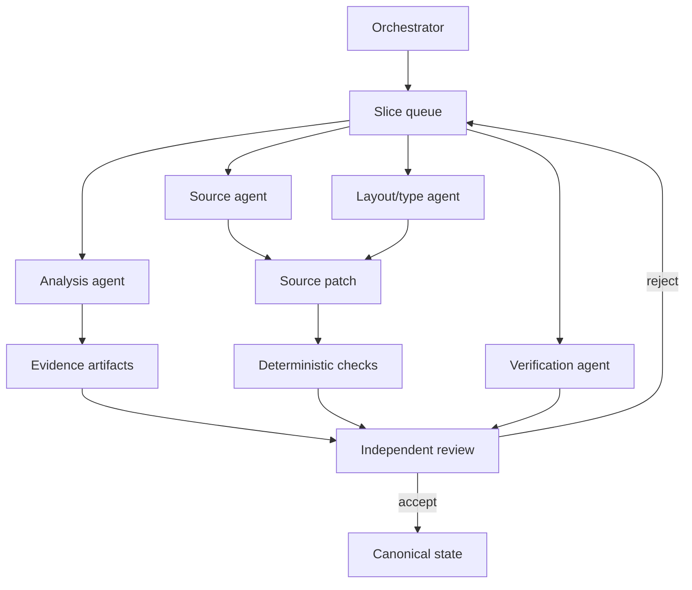

# Long-Goal Plan

The project advances through **slices**. A slice is a bounded, reviewable unit of decompilation work with explicit inputs, evidence, outputs, ownership, and verification.

This is not a phase-gated project. Different slices may run concurrently when their evidence dependencies are satisfied.

## Slice lifecycle

```mermaid
flowchart LR
    Q[Queued] --> C[Claimed]
    C --> E[Evidence gathered]
    E --> H[Hypothesis/reconstruction]
    H --> B[Build]
    B --> S[Static compare]
    S --> R[Runtime verify]
    R --> V[Review/validate]
    V --> M[Merged]
    H --> E: contradiction
    B --> H: compile/layout failure
    S --> H: incorrect reconstruction
    R --> H: behavior mismatch
    V --> E: evidence insufficient
```

## Slice manifest

Every active slice has a machine-readable record, for example:

```yaml
id: fn-00123450
kind: function
target: GAME
address: 0x00123450

claimed_by: agent-id
depends_on: []

evidence:
  - ref: sndata:symbol:123
  - ref: elf:function:0x00123450
  - ref: ghidra:function:0x00123450

expected_outputs:
  - src/.../Player.cpp
  - reference/functions/00123450.json

acceptance:
  build: required
  lint: required
  static_compare: required
  runtime: required

status: claimed
```

Only the orchestrator changes lifecycle ownership fields. Worker agents change source/evidence artifacts through normal reviewed commits.

## Work graph



## Foundation slices

These are normal trackable slices, not disposable setup work.

### Input identity

Output:

- ISO hash;
- extracted-file manifest and hashes;
- target executable/module identity;
- gitignore rules preventing private input publication.

Acceptance:

- extraction repeated twice produces identical manifests.

### Debug preservation

Collect and preserve every available source of debug evidence:

- `.sndata`;
- `.mdebug`/STABS;
- ELF symbols;
- section metadata;
- other discovered debug formats.

Output is lossless canonical metadata plus raw decoded fields. Unknown fields remain preserved as unknown.

### Source-tree recovery

Build `reference/files.json` from debug evidence.

Rules:

- raw paths are preserved verbatim;
- repository-safe mapping is deterministic;
- no guessed path becomes canonical;
- original case is retained where the host filesystem permits it;
- collisions are explicitly represented and resolved without losing originals.

### Compiler/toolchain fingerprinting

Track evidence for:

- compiler family;
- exact version;
- assembler;
- linker;
- C++ dialect;
- ABI;
- optimization flags;
- per-TU differences.

Do not select a historical compiler merely from weak family evidence.

If exact historical source semantics cannot be established, the affected code uses the project fallback of C++20 without pretending that C++20 was historical.

## Decompilation slices

Preferred granularity:

1. source file / translation unit when confidently recovered;
2. class or tightly coupled function family;
3. individual function where dependencies are limited;
4. data/vtable/layout unit.

Functions inside an evidenced original TU remain in original-address order unless stronger source-order evidence exists.

## Required evidence trail

Every merged reconstruction must make the following query answerable:

> Why does the repository claim this entity has this name, file, signature, type/layout, implementation, and status?

Evidence records should point to immutable/generated references, not prose such as “Ghidra looked like this.”

## Multi-agent orchestration



Rules:

- no two agents concurrently own the same canonical entity unless explicitly collaborating;
- analysis and verification should be independent where practical;
- agents may add hypotheses, but canonical metadata requires evidence;
- an agent may not promote its own unsupported hypothesis by changing the confidence label;
- contradictory evidence is recorded, not overwritten;
- generated reports are tied to commit/tool/input identities;
- all source changes are attributable to a slice.

## Mandatory gates

`just check` should eventually enforce:

```text
input/reference consistency
metadata schema validation
source annotation lint
path/TU consistency
target build
ABI/layout assertions
object/function comparison
data/vtable comparison
runtime tests where defined
slice-manifest consistency
unresolved-conflict checks
```

## Progress ledger

Generated reports should expose at least:

```text
identified
source-file known
decompiled
recompilable
functional
matching score
type/layout verified
vtable verified
data verified
unresolved
blocked-by-evidence
```

Do not reduce these to one misleading percentage.

## YIPPEE acceptance

YIPPEE is emitted only when:

- all required executable game code is accounted for;
- all reconstructed code builds;
- preserved assembly is intentional and classified;
- no required behavior is implemented by speculative/dummy stubs;
- whole-game runtime verification reaches the defined functional bar;
- canonical metadata contains no unresolved conflicts affecting required behavior;
- reports can trace every required entity to evidence and source;
- a clean clone plus private original input can reproduce the rebuilt target.

Instruction/byte matching may continue after this marker.
