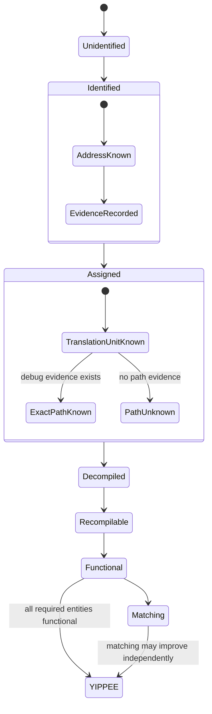
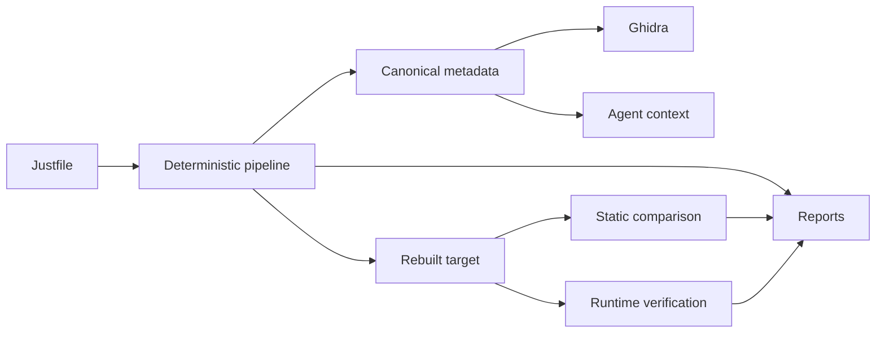

# Product Definition

## Product

A reproducible PS2 decompilation workspace that reconstructs the original game's C/C++ source structure and behavior while continuously measuring fidelity against the original executable.

The system is designed for long-running work performed by humans and multiple AI agents without losing provenance or allowing speculative reverse-engineering claims to become canonical facts.

## Final outcome

The end product is:

- a complete recompilable source tree;
- functionally equivalent game behavior;
- reconstructed source files placed at recovered original paths where evidence supplies them;
- recovered original symbol names preserved verbatim;
- recovered original types/layouts preserved where evidence supplies them;
- original compiler/toolchain reproduced where determinable;
- C++20 used only as the fallback source language when the historical dialect cannot be established;
- deterministic build/comparison/test/report commands;
- complete provenance for reconstructed entities;
- private original media excluded from version control.

## Success state



`Matching` is not a prerequisite for YIPPEE. A function may be functionally correct but not instruction-identical because of compiler entropy, unknown historical compiler details, link ordering, register allocation, or other code-generation differences.

## Non-negotiable product requirements

### Determinism

Given the same private input ISO, repository revision, tool versions, and configured toolchain:

- extraction is repeatable;
- metadata generation is repeatable;
- source-path mapping is repeatable;
- builds are repeatable;
- reports are reproducible;
- agent context generation is reproducible.

### Traceability

Every canonical reconstruction claim must identify its evidence.

Minimum entity record:

```json
{
  "id": "function:0x00123450",
  "kind": "function",
  "address": "0x00123450",
  "canonical_name": "CPlayer::Update",
  "raw_symbols": [],
  "source_file": null,
  "evidence": [],
  "confidence": "unknown",
  "status": {
    "identified": true,
    "decompiled": false,
    "functional": false,
    "matching": null
  }
}
```

### No invention

Canonical data may contain:

- `exact`
- `strong`
- `inferred`
- `unknown`

It may not silently contain guessed facts.

Examples:

- known debug filename → `exact`;
- function boundary from ELF symbol size → `exact`;
- function extent from next symbol → `inferred`;
- class field purpose guessed from one load → remains unnamed;
- probable file inferred from namespace → not canonical unless explicitly recorded as a hypothesis.

### Original-source fidelity

When evidence exists, preserve:

- file and directory names;
- translation-unit membership;
- symbol spelling and mangling;
- classes/namespaces;
- source ordering where recoverable;
- compiler dialect;
- ABI-sensitive declarations;
- member offsets;
- vtable ordering;
- globals and static storage;
- historical idioms.

Modern refactoring is outside this product.

## Users

Primary operators:

- reverse engineers;
- build/tooling agents;
- source-reconstruction agents;
- verification agents;
- orchestration agents.

Agents have bounded roles. No agent owns truth independently.

## Product surfaces



## Completion metrics

Tracked independently:

- functions identified;
- functions assigned to an evidenced TU;
- functions decompiled;
- functions recompilable;
- functions runtime-verified;
- instruction similarity;
- global/data coverage;
- type/layout coverage;
- vtable coverage;
- exact source-path recovery;
- unresolved evidence conflicts;
- unsupported assembly/VU/IOP units.

YIPPEE requires functional completeness and zero unresolved required-code gaps, not a 100% byte-match score.
