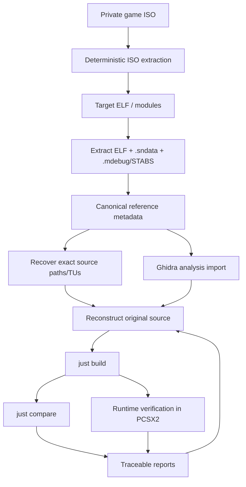

# God Hand (PS2, USA) decompilation

A deterministic, evidence-driven PlayStation 2 decompilation project modeled after the workflow used by the LEGO Island decompilation project.

The target is a **functionally complete, recompilable codebase whose rebuilt executable is behaviorally equivalent to the original game**, while preserving original source structure, names, types, compiler behavior, and machine-code layout as far as evidence allows.

Byte-for-byte binary identity is not required for completion. Instruction/data matching remains tracked independently and can continue after functional completion.

## Completion: `YIPPEE`

The project reaches **YIPPEE** when all required game code has been reconstructed and:

- every required executable unit is represented by source or intentionally preserved assembly;
- the project builds reproducibly from the repository;
- the rebuilt game is functionally equivalent under the verification suite;
- known source files, source paths, symbols, types, globals, vtables, and translation units have been preserved where supported by evidence;
- no required behavior depends on invented stubs;
- all reconstructed entities are traceable to original evidence;
- comparison and coverage reports account for the complete target.

Exact byte identity is tracked separately.

## Design principles

1. **Evidence is authoritative.**
   Debug symbols, `.sndata`, `.mdebug`/STABS, ELF metadata, original assembly, runtime behavior, and reproducible tool output outrank guesses.

2. **Preserve the original project.**
   If debug information gives an original directory, filename, symbol, namespace, type, or translation unit, keep it.

3. **Do not modernize known original code.**
   Determine and reproduce the original C++ dialect, compiler, flags, ABI, layout, and idioms where possible.

4. **Fallback language level is C++20.**
   C++20 is used only where the historical source/toolchain cannot be determined reliably.

5. **Every reconstruction is traceable.**
   Each function, global, type, file assignment, and structural claim records its evidence and confidence.

6. **Agents cannot invent facts.**
   AI agents may propose hypotheses, but unverified hypotheses are never promoted to canonical project state.

7. **One canonical metadata model.**
   Ghidra, comparison tools, generated source maps, reports, and agents consume the same canonical metadata.

8. **Original media stays private.**
   The ISO and extracted copyrighted game data live inside the repository working tree but are gitignored.

## Repository layout

```text
.
├── README.md
├── PRODUCT.md
├── PLAN.md
├── ARCHITECTURE.md
├── AGENTS.md
├── Justfile
│
├── config/
│   ├── project.toml
│   ├── compiler.toml
│   └── overrides.toml
│
├── original/                 # gitignored
│   ├── SLUS-21503.iso
│   ├── extracted/
│   └── hashes.json
│
├── reference/                # generated, evidence-preserving metadata
│   ├── elf.json
│   ├── sections.json
│   ├── symbols.json
│   ├── files.json
│   ├── functions.json
│   ├── globals.json
│   ├── types.json
│   ├── vtables.json
│   └── compiler-evidence.json
│
├── src/                      # recovered original source paths
├── include/                  # recovered original include paths
├── asm/                      # preserved/recovered assembly
├── linker/
├── tools/
├── tests/
├── reports/
├── .agents/                  # project-local Agent Skills (`$forge-skill-creator`), agent-only tools and whatnot
└── build/                    # gitignored
```

## Source-path preservation

Recovered source paths are not reorganized for aesthetics.

If debug information contains:

```text
C:\work\game\src\player\Player.cpp
```

the raw path is preserved in metadata exactly, while a deterministic repository-safe mapping is stored separately.

Example:

```json
{
  "debug_path_raw": "C:\\work\\game\\src\\player\\Player.cpp",
  "repo_path": "src/work/game/src/player/Player.cpp",
  "path_source": ".mdebug/STABS",
  "confidence": "exact"
}
```

No source file may be assigned to a guessed directory merely because a namespace, class name, or neighboring function suggests it.

## Normal workflow



## Core commands

The public workflow is exposed through `just`; implementation details may use native or external CLI tools.

```text
just verify-input
just extract
just analyze
just import-ghidra
just build
just lint
just compare
just compare-fn <address>
just datacmp
just vtable
just roadmap
just context <address>
just test
just report
just check
```

`just check` is the mandatory aggregate gate for canonical changes.

## External foundations

The workflow intentionally borrows the deterministic model of:

- LEGO Island decompilation: <https://github.com/isledecomp/isle>
- reccmp: <https://github.com/isledecomp/reccmp>
- LEGO Racers decompilation conventions: <https://github.com/isledecomp/racers>

PS2-specific components may include:

- objdiff: <https://github.com/encounter/objdiff>
- splat: <https://github.com/ethteck/splat>
- Ghidra Emotion Engine Reloaded: <https://github.com/chaoticgd/ghidra-emotionengine-reloaded>
- ccc/stdump/uncc for PS2 debug information: <https://github.com/chaoticgd/ccc>
- sndata-converter: <https://github.com/Longestboi/sndata-converter>

These are implementation components, not independent sources of project truth.
